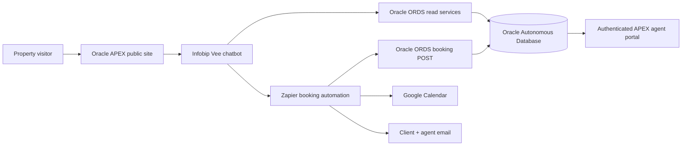

# 🏠 iKhayaLam Properties

**IFS325 Group Project · Use Case 6 · University of the Western Cape**

*Find a place to call home.* iKhayaLam is an Oracle APEX property-discovery and viewing-request prototype connecting people looking to rent or buy with estate agents through an Infobip Vee chatbot and an automated request workflow.

> **Project status:** The team reports the accepted prototype's rent/buy search, database-backed images, booking journey, email/Calendar actions, agent dashboard, follow-up editing and informational FAQ buttons as operational. This repository is a documented project handover, **not** an independent production security certification.

## Contents

- [What it does](#what-it-does)
- [Architecture overview](#architecture-overview)
- [Technology](#technology)
- [Usage](#usage)
- [Setup for maintainers](#setup-for-maintainers)
- [Repository structure](#repository-structure)
- [Project team](#project-team)
- [Scope and limitations](#scope-and-limitations)
- [Evidence and technical documents](#evidence-and-technical-documents)
- [Security](#security)
- [Contributing and license](#contributing-and-license)

## What it does

- Separate **rental** and **buying** catalogues with filters for property type, location, budget and bedrooms.
- Property detail pages with prices, location, description and database-backed images.
- Embedded **Infobip Vee** to interpret user search preferences, show listing carousels and guide a selected-property viewing request.
- Customer details and South African viewing date/time validation; requests use a **one-hour** event duration.
- **Zapier** routes the booking to the Oracle data store, creates a Google Calendar entry and sends client and agent confirmation/notification messages.
- Secured **agent staff portal** with assigned-client/viewing data, status changes and follow-up notes.
- Informational **FAQs & Enquiries** page, with direct chatbot buttons for the relevant sections on cancellation, changing viewings and general queries.

## Architecture overview



This diagram summarises observed system responsibilities. The team's **approved final to-be system architecture and BPMN diagrams have not yet been supplied** and should replace or supplement this conceptual flow before final submission.

## Technology

| Layer | Technology |
|---|---|
| User interface | Oracle APEX Application 103, HTML, CSS Master V6, JavaScript |
| Database | Oracle Autonomous Database, SQL and PL/SQL |
| Data services | Oracle REST Data Services (ORDS) — selected GET/POST services |
| Chatbot | Infobip Answers and Live Chat (Vee) |
| Workflow automation | Zapier |
| Scheduling | Google Calendar |
| Notifications | Configured email connector(s) in the Zapier workflow |
| Integration testing | Postman, Oracle APEX and SQL Workshop |

## Usage

**Public visitor:** Open the deployed APEX website, choose Rent or Buy, apply filters and select View Property. Use the chat launcher or the Book a Viewing button to continue. Enter customer details and a suitable viewing date/time. The service creates a *viewing request*; the estate agent handles final appointment decisions.

**Estate agent:** Sign in through **Staff Portal**, view assigned requests on **Page 8**, open one on **Page 9** to edit booking status/follow-up notes, and use **Page 10** for client leads. The public FAQ on **Page 11** explains how customers email their responsible agent for cancellation and rescheduling.

**Live public application (verify before publishing):** https://ge12da41765e3b0-ikhayalam.adb.me-jeddah-1.oraclecloudapps.com/ords/r/ikhayalam_ws/ikhayalam-properties/welcome-to-ikhayalam

For step-by-step use see [User Guide](docs/User_Guide.docx).

## Setup for maintainers

This is **not a standalone Node.js or Python application**. Running the system requires an Oracle APEX workspace and corresponding Oracle database, connected Infobip project and a configured Zapier automation; `npm install` does not deploy it.

1. Obtain an approved Oracle APEX application export and a scrubbed database schema/seed data from the custodian (neither contains passwords).
2. Import into an authorised Oracle APEX workspace and map tables, roles and the correct schema.
3. Add the V6 stylesheet using the [CSS installation guide](frontend/ikhayalam_master_v6_installation.md).
4. Configure ORDS GET/POST handlers in the private administrator console. API operations are named in [Public API Overview](docs/API_Operations_Public.md), without exposing private routes or keys.
5. Import/recreate Infobip chatbot flows and set service integrations inside its secured configuration.
6. Import/recreate the Zapier workflow and connect authorised Oracle, calendar and email accounts.
7. Verify all public, staff, conversation, booking and notification scenarios against [Test Plan](docs/Test_Plan.md).

For more details see [Deployment and Configuration](docs/Deployment_and_Configuration.md).

## Repository structure

```text
README.md
.gitignore
SECURITY.md
CONTRIBUTING.md
docs/
  User_Guide.docx
  Technical_Overview.docx
  API_Operations_Public.md
  Deployment_and_Configuration.md
  Architecture_and_Data_Flow.md
  Test_Plan.md
  Release_and_Publication_Checklist.md
frontend/
  ikhayalam_master_v6.css
  ikhayalam_master_v6_installation.md
screenshots/
  README.md
```

## Project team

| Member | Group assignment role |
|---|---|
| Hluma Mahlasela | Project Manager / Integration Lead |
| Magedi Thokwane | Business Analyst / Research Lead |
| Munashe Machaka | Process Analyst / Tester |
| Mvelo Shange | Requirements & Quality Assurance Lead |
| Siphesihle Skosana | Systems Architect / Developer |

Contributor-to-code or commit attribution should be aligned with the approved group contribution record.

## Scope and limitations

The prototype does not enforce exclusive viewing slot locking. Different customers may request the same slot; an estate agent resolves scheduling. Cancellation and rescheduling are **not** self-service transactions; users receive instructions to email the property agent. There is no enquiry-submission table/form, live bond/payment system, dedicated 24-hour and 1-hour reminder automation, or automated agent-escalation process. A calendar event is created for a request but should not be misrepresented as a confirmed appointment.

## Evidence and technical documents

- [User Guide](docs/User_Guide.docx)
- [Technical Overview](docs/Technical_Overview.docx)
- [Test Plan](docs/Test_Plan.md)
- [Architecture notes](docs/Architecture_and_Data_Flow.md)
- **Approved to-be BPMN/system architecture:** pending team-supplied diagrams.
- **Video presentation and slide deck:** to be attached/submitted separately when compiled.
- Screenshots should be **redacted**, excluding customer details and secret headers.

## Security

No passwords, API keys, JWT signing material, private Zapier URLs, customer data or assessor credentials belong in this public repository. See [SECURITY.md](SECURITY.md). Detailed private endpoint inventory and access instructions are provided **only in the restricted assessor package**.

## Contributing and license

See [CONTRIBUTING.md](CONTRIBUTING.md) for project-team collaboration. **No open-source licence has been granted in this pack.** Repository visibility and licence choice require approval from the group and rights holders. Do not copy an example template's MIT licence without that approval.

## Public code and demonstration fixtures

This pack includes the shared **Master V6 CSS** and selected APEX HTML/SQL source excerpts under `frontend/apex_static_content/` and `examples/sql/`. The `examples/synthetic_listing.json` file is a safe **illustrative** record, not live data. The Infobip rules are explained in [`docs/Infobip_Flows_and_Rules.md`](docs/Infobip_Flows_and_Rules.md). See [`docs/Still_To_Insert_Before_Submission.md`](docs/Still_To_Insert_Before_Submission.md) for owner-supplied exports, diagrams, screenshots and video.
